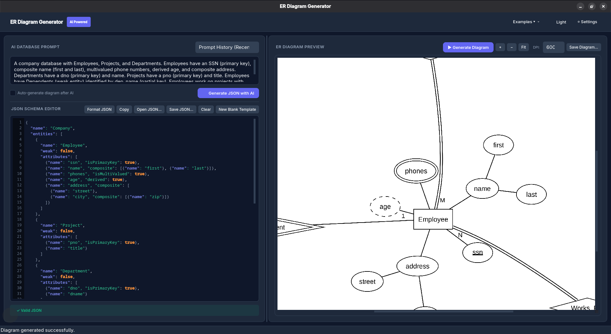

# ER Diagram Generator

A Python application that turns a natural-language database description or a JSON schema into an Entity-Relationship (ER) diagram.

The project uses Google Gemini to generate and refine database models, Pydantic to validate the model structure, and Graphviz to render the final diagram as a PNG image.

## Features

- Generate an ER model from a natural-language description.
- Load and validate an existing JSON database model.
- Select JSON files through a file picker.
- Edit and reload `database.json` from the application.
- Ask the AI to refine an existing model.
- Model strong and weak entities.
- Support primary keys and partial keys.
- Support composite, multivalued, and derived attributes.
- Support binary and ternary relationships.
- Display cardinality and total or partial participation.
- Render the diagram to `er-diagram.png`.

## Requirements

- Python 3.10 or newer
- Graphviz
- A Google Gemini API key
- A graphical desktop environment for the file picker and automatic image opening

### Install Graphviz on Ubuntu or Debian

```bash
sudo apt update
sudo apt install graphviz python3-tk
```

## Installation

Create and activate a virtual environment:

```bash
python3 -m venv env
source env/bin/activate
```

Install the Python dependencies:

```bash
pip install pydantic pydantic-core python-dotenv graphviz langchain-google-genai
```

Create a local `.env` file in the project directory:

```env
GEMINI_API_KEY=your_gemini_api_key
```

Do not commit `.env` or expose API keys. The file is ignored by Git.

## Running the Application

### GUI Mode (Recommended)

Launch the modern desktop GUI:

```bash
python gui.py
```

#### GUI Features

- **Split-Panel Layout**: Natural language AI prompt and code-style JSON editor on the left, interactive diagram preview on the right.
- **Three Input Paths**: Generate schemas from descriptions via Gemini AI, write/edit JSON directly in the editor, or import existing `.json` files via file picker or drag & drop.
- **Live Debounced Validation (~400ms)**: Real-time syntax and schema verification with exact line/column indicators and offending line highlighting.
- **Review Before Render**: AI-generated models are placed directly into the editor for review and manual refinement before drawing.
- **Diagram Preview & Navigation**: Smooth zoom controls (+ / − / Fit), mouse wheel zoom (`Ctrl + Wheel`), and drag-to-pan navigation.
- **Multi-Format Export**: Save your diagram as PNG, SVG vector, or PDF directly to any location.
- **Modern Themes**: Clean Dark mode (default) and Light mode with persistent state.
- **Ready-Made Examples**: Quick-load Company (Lab 1), University System, and Hospital Management examples from the top menu.
- **Settings Dialog**: Easily configure your Gemini API key (persisted to `.env` only) and select the Gemini model.

#### Keyboard Shortcuts

| Shortcut | Action |
| --- | --- |
| `Ctrl + Enter` | Generate ER Diagram |
| `Ctrl + G` | Generate JSON with AI |
| `Ctrl + S` | Save Diagram (PNG, SVG, PDF) |
| `Ctrl + O` | Open JSON file |
| `Ctrl + Shift + F` | Format / Pretty-print JSON |
| `Ctrl + Wheel` | Zoom in / Zoom out diagram |

#### Screenshot



### CLI Mode

```bash
python main.py
```

Choose one of the input modes:

1. **Description**: enter a natural-language description. The application generates a validated database model and saves it to `generated_database.json`.
2. **JSON file**: choose an existing JSON file using the file picker.

After a model is loaded, the application allows you to:

1. Draw the ER diagram.
2. Open and edit `database.json`, then reload it.
3. Ask the AI to modify the current model.
4. Generate a new model from a different description.

The generated image is saved as `er-diagram.png` and opened automatically when possible.

## JSON Model Format

A database contains a name, entities, and relationships:

```json
{
  "name": "Company",
  "entities": [
    {
      "name": "Employee",
      "weak": false,
      "attributes": [
        {"name": "ssn", "isPrimaryKey": true},
        {"name": "name", "composite": ["first", "last"]},
        {"name": "phone", "isMultiValued": true},
        {"name": "age", "derived": true}
      ]
    }
  ],
  "relationships": [
    {
      "name": "Works_For",
      "entities": ["Employee", "Department"],
      "cardinalities": ["N", "1"],
      "participations": ["total", "total"],
      "attributes": [],
      "identifying": false
    }
  ]
}
```

### Entity attributes

- `isPrimaryKey`: draws an underlined attribute.
- `isPartialKey`: draws a dashed-underlined attribute for a weak entity.
- `composite`: contains attribute names or nested attribute objects.
- `isMultiValued`: draws a double oval.
- `derived`: draws a dashed oval.

### Relationships

- `entities`: entity names in relationship order.
- `cardinalities`: one value per entity, using `1`, `N`, or `M`.
- `participations`: use `total` or `partial` for each entity.
- `identifying`: draws a double diamond for an identifying relationship.
- `attributes`: attributes belonging to the relationship itself.

The model validator also accepts compact relationship input such as `entity1`, `entity2`, `cardinality: "1:N"`, and `participation: "partial:total"`.

## Testing

Run the model and rendering checks with:

```bash
python testing.py
```

The test script validates the Pydantic schema and renders a sample ER diagram.

## Project Structure

| File / Directory | Purpose |
| --- | --- |
| `gui.py` | Desktop GUI entry point |
| `ui/` | GUI components (editor, preview, validator, workers, themes) |
| `main.py` | Interactive CLI application workflow |
| `models.py` | Pydantic database, entity, attribute, and relationship models |
| `ai.py` | Gemini integration for generating and refining models |
| `graph.py` | Graphviz ER diagram rendering |
| `file_picker.py` | JSON file selection dialog |
| `helper_func.py` | File I/O, AI error handling, and automatic file opening |
| `database.json` | Example/editable database model |
| `er-diagram.png` | Rendered diagram output |
| `testing.py` | Schema and rendering checks |
| `test_gui.py` | Headless GUI test suite |
| `requirements.txt`| Application dependencies |

## Security Notes

- Keep API keys only in the local `.env` file.
- If an API key is ever pushed to GitHub, revoke it and create a replacement immediately.
- Generated files and local notes are excluded through `.gitignore`.
